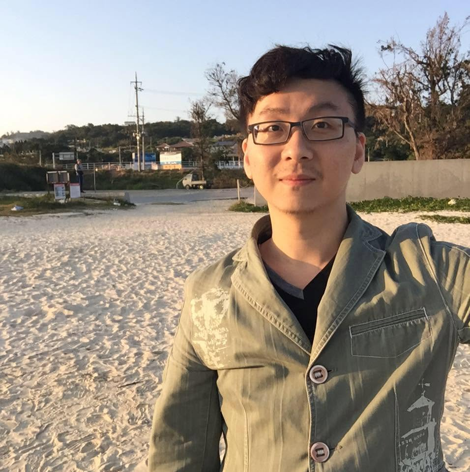

# Sunkcost

## 成員資料

Member ID：000017
GitHub：[flsteven87](https://github.com/flsteven87)
Threads：[sunkcost587](https://www.threads.com/@sunkcost587)

## 我是誰

大家好，我是 Sunkcost，台灣的獨立開發者，背景是資料分析。近兩年用 AI 開發自己的產品，也開始在 Threads 記錄開發過程、遇到的問題和心得。

現在的工作流程大量使用 AI Agent，從需求研究、開發、測試到上線後的營運，都在實際摸索。做產品時，我會先把問題和想驗證的事情講清楚，再看結果是否支持原本的判斷。

## 我正在做的產品

[ReadShore](https://readshore.app/) 是專為 AI 時代設計的稍後閱讀 App。除了保存文章和貼文，也能透過 MCP，讓支援這個協定的 AI Agent 搜尋、閱讀自己的書庫。

[Replai](https://replai.tw/) 是給 SaaS 團隊使用的 AI 客服。團隊提供產品知識，讓 AI 回答使用者的問題，需要人處理時再接手。

## 為什麼想加入

希望和大家一起學習、交流激盪，也尋求雙贏的合作機會。

## 想要獲得什麼

希望透過持續交流，更了解彼此在做什麼、遇到哪些問題，以及各自能提供什麼。若找到適合一起做的事，再討論合作方式。

## 想分享什麼

- 資料分析與產品判斷：如何釐清問題、安排驗證，以及從結果調整下一步。
- AI 輔助開發的實務：從需求、開發到驗收與交付，分享實際做法與踩過的坑。
- 做 iOS App、SaaS 和 MCP 串接的經驗，以及產品上線後的回饋與營運問題。

## 我的 Contributions：可以幫什麼忙、想要幫什麼忙

### 可以幫什麼忙

可以透過 AI Agent 協作，參與網站、小型工具與 AI 應用的開發和改善，也可以一起討論產品需求、驗證方式與開發流程。

### 想要幫什麼忙

我想先參與 Hacker，從需求明確、範圍適合的網站、工具或系統開發開始。承接具體工作前，會先確認範圍和可投入的時間；接受後會負責完成，無法繼續時會說明並交接。

## 我對參與方式的理解

我願意遵守組織憲法與現行制度，依自己的時間交流、學習與協作。介紹產品是為了讓大家理解我的經驗，不以組織的名義、知識內容或活動推銷產品或服務。
