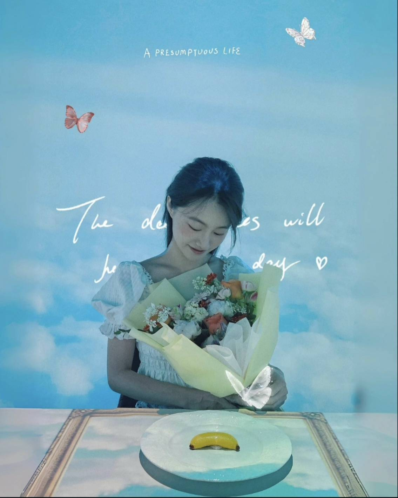

# Kelsi



## 成員資料

Member ID：待配置
GitHub：[Kelsidreamland](https://github.com/Kelsidreamland)

```yaml
discord_id: "690396985987039272"
```

## 我是誰

我是 Kelsi，數位遊牧快五年，這幾年幾乎都不在台灣。

我一直很難用一個職稱介紹自己。以前當特助的時候，人資姐姐說我是團隊的前哨兵：先去追最新的科技和資訊，自己動手做實驗，再整理成策略建議，交給老闆拍板。

現在拍板的人換成我。我和另一半一起經營生活和事業，我負責研究、實驗、決定方向，執行交給他和我們的 AI 助理。打王者榮耀我也都選輔助。

我做過電商品牌的社群行銷和 PM，遊牧這幾年辦過三場數位遊牧共居活動。喜歡玩科技，從 Web3 玩到 AI，最近在研究讓 AI 直接操作手機（phone use），還有整套 AI 助理系統怎麼搭。也喜歡投資和地理套利：趁著能到處移動，比較各地的生活成本、資源和制度，找到更適合自己的配置。

其他聯絡方式或作品連結：La Vita Nomad https://lavitanomad.com

## 為什麼想加入

這是我第一次加入創業社群。我很喜歡「把經驗寫成開源筆記，後面的人就不用重新造輪子」這個做法。這幾年遊牧、辦活動、和 AI 助理一起過日子，我累積了很多做過也踩過坑的經驗，想跟同樣在試的人交流。

## 想要獲得什麼

- 認識同樣用 AI 經營生活和事業的人，交換彼此的工作流。
- 聽前輩怎麼看一兩個人的小團隊，還有出海時的法人、稅務和身分規劃。

## 想分享什麼

- 沒有工程背景，也能和 AI 助理一起經營生活和事業：怎麼分工、怎麼交辦，哪些事交出去之後真的省下時間。
- 遊牧快五年的經驗：一邊移動一邊工作，用地理套利的角度比較各地的成本和資源。
- 辦數位遊牧共居活動：怎麼招募、怎麼安排共同生活、大家怎麼磨合。
- 從 Web3 玩到 AI 助理的工具心得和踩坑紀錄。

## 我的 Contributions：可以幫什麼忙、想要幫什麼忙

### 可以幫什麼忙

- 分享 AI 助理的生活和工作流，寫筆記或上台分享都可以。
- 活動企劃：辦過三場數位遊牧共居活動。
- 社群行銷和內容建議：有電商品牌社群行銷背景。

### 想要幫什麼忙

- 活動籌辦與協助：想一起企劃交流活動或分享會。
- 開源創業知識及流派整理：想整理「遊牧＋AI-Native 小團隊」這一派。

## 參與原則

我會遵守組織憲法，依自己的時間參與交流、學習和協作。認領的工作會負責完成，做不下去會先說，也會交接好。分享經驗是為了交流，不會用組織的名義推銷任何產品。
