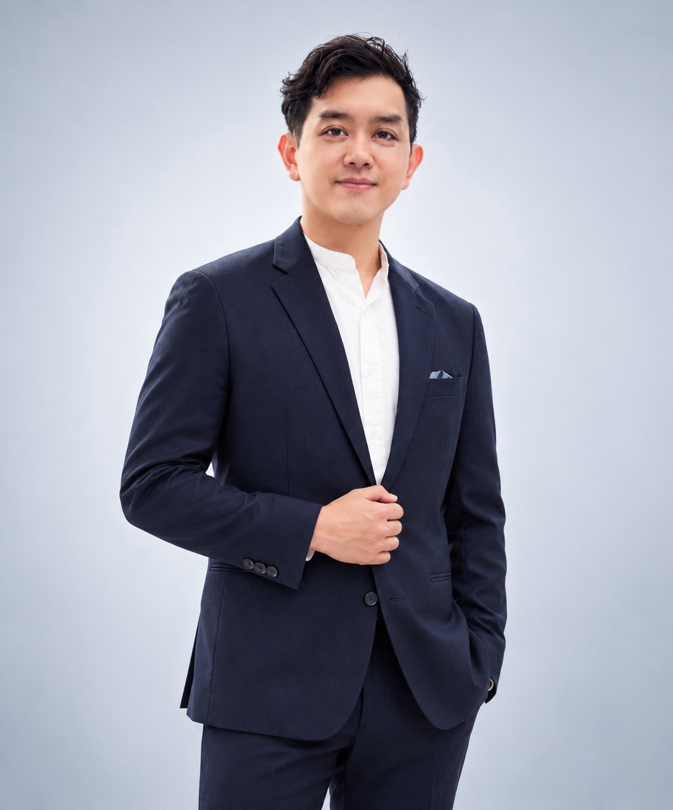

# Dex（盧冠宏）



## 成員資料

Member ID：待配置
GitHub：lu791019

```yaml
discord_id: "844513999718842388"
```

## 我是誰

我是 Dex。我用技術理解問題，用教學傳遞方法，也用陪伴促成改變。

我不是資訊本科。過去十年跨過四個產業、六家公司，從半導體缺陷分析，一路走到資料工程與 AI 應用開發：

- **現職：** 哈馬星科技 Tech Leader／AI 應用開發主任工程師，帶 2 人工程團隊，負責 AI 與物件辨識產品；另一個 AI SaaS 產品同時擔任產品經理與技術開發者
- **過去經歷：** 緯創資通後端與資料工程師、LINE Bank 資料工程師、TutorABC 大數據工程師、台灣美光缺陷分析工程師
- **行銷：** 曾任行銷專員，把技術內容轉譯成學習者願意讀、願意行動的語言
- **教學與陪跑：** TibaMe 雲端資料工程師養成班指導業師，也在多個轉職課程擔任專題教練；在高中、大學、企業內訓與線上講座分享 AI 與職涯主題
- **生涯教練：** CDA 國際生涯發展諮詢師、AndAction Life Coach、104 Giver
- **社會參與：** 台灣全齡生涯發展協會理事；參與 T-Cross（T 大使）計畫，與左鎮在地的左達工作室協作臺南左鎮智慧街區；也為合照盟開發 AI 數位轉型工具；g0v 島島阿學核心成員、PyCon TW 議程組與行銷組
- **內容：** 經營 DayDreamDex 塵世哲學，包含部落格、電子報《我與經驗值 I and EXP》與 Podcast，也以「塵世影導」身分寫影評

其他聯絡方式或作品連結：
- [daydreamdex.com](https://daydreamdex.com/)

- 作品：
- [練功房](https://learn.daydreamdex.com/)、
- [散場誌](https://castflow.daydreamdex.com/)、
- [Threads @daydreamdex](https://www.threads.net/@daydreamdex)、
- [portaly.cc/daydreamdex](https://portaly.cc/daydreamdex)

## 我正在 build 的產品或專案（選填）

這兩年我開始把自己做的東西產品化，大多用 Claude Code 一個人從需求做到上線：

- **[練功房](https://learn.daydreamdex.com/)：** 給自學或轉職中的資料工程與 AI 學習者的練題平台。帶轉職班時我看到，課一週三次，卡點卻每天發生，所以想用產品補上這段空白。打開瀏覽器就能寫 Python、自動對答案，卡住時有不給答案、但會陪你往下想的 AI 教練。我希望它之後能讓任何機構或創作者都能在上面開班。
- **[散場誌](https://castflow.daydreamdex.com/)：** 我的自有產品，一本會長大的個人觀後誌。正式站已上線，還在開發期，尚未對外推廣。
- **合作路書：** 為合作社輔導計畫做的 AI 文件助手。兼職的合作社成員填表或錄音，就能產出合規的 Word／PDF 並自動歸檔。
- **AI 多媒體平台：** 從接案走向產品化的多租戶照片管理 SaaS。
- **[Dex Agent OS](https://github.com/lu791019/dex-agent-os)：** 我自己每天在用的個人 AI 代理人工作流，把工作紀錄和學習筆記整理成日記、洞察與各平台的內容草稿。

## 為什麼想加入

我想嘗試創業，或者說，嘗試成為一個經營者：結合自己的技術能力，用營運思維來經營產品。

這幾年我一直在做跨職能的事：寫程式、帶團隊、當 PM、教學、陪人轉職，也開始把自己的工具做成產品。Agentic Coding 讓我做得出東西，當 PM 讓我知道該做什麼、做到哪裡算夠好。但產品做得出來只是第一步。怎麼找到使用者、驗證市場、設計商業模式，讓它持續營運下去，是我接下來想學會的事。

這個組織想把創業經驗整理成開源知識，讓後來的人不必每次都重新摸索，這正是我現在需要的。我曾經是被引導的人，後來變成引導別人的人，也一直相信，有人陪你把問題想清楚，比直接給答案更有力量。我希望在這裡一邊學，一邊把自己的經驗分享出來。

## 想要獲得什麼

- 了解其他創辦人怎麼從做產品走到經營產品：營運、成長、定價與商業模式怎麼決定。
- 釐清像練功房、散場誌這類自有產品，要怎麼驗證市場、找到渠道，以及什麼時候該投入更多。
- 認識一起用 AI 打造產品的人，交流做法，也互相試用彼此的產品。

## 想分享什麼

- 非資訊本科跨進資料工程與 AI 的轉職經驗，以及十年跨四個產業的職涯轉換。
- 一個人用 Claude Code 和多 agent 工作流，從需求做到上線的實際做法，包含驗收機制與 agent 記憶的實測心得。
- 把技術導入地方創生與非營利組織的經驗：先理解在地的人和需求，再決定科技能扮演什麼角色，並讓系統在工程師離場後還活得下去。
- 職涯諮詢與教練式提問的方法，用來陪人釐清方向。

## 我的 Contributions：可以幫什麼忙、想要幫什麼忙

### 可以幫什麼忙

- **技術開發：** 熟悉 Python、SQL、TypeScript、FastAPI、資料管線與 LLM 應用，能參與網站、AI 自動化或內部工具的開發。
- **知識整理與轉譯：** 能把訪談、案例或技術內容整理成非技術背景的人也讀得懂、可以持續維護的文件。
- **講座與工作坊：** 能協助規劃或主講 AI、資料工程、職涯轉換等主題的分享。
- **陪伴與引導：** 能用教練式提問，陪還在探索的人釐清自己的問題。

### 想要幫什麼忙

- **開源創業知識及流派整理：** 想把創業者的經驗、訪談與案例整理成好讀、可搜尋、可持續維護的開源知識，也想試試用 AI 降低整理與維護的成本。
- **Hacker：** 想參與組織網站、AI 自動化與內部工具的開發和改善。
- **活動籌辦與協助：** 想協助講座、工作坊的規劃與主持，也可以分享 AI、產品開發與職涯轉換等主題。

承接具體工作時，我會先確認範圍與可投入的時間，並對答應的事情負責。

## 基本義務

我願意遵守憲法與現行制度，不以組織的名義、知識內容或活動推銷特定公司的產品或服務。我會保有參與意願，以交流、學習、協作或回覆持續參與；接受具體工作後會履行，無法繼續時主動揭露並交接。

我另外提供付費的顧問導入、1on1 職涯諮詢、企業內訓與講座，也在轉職班擔任業師。這些工作與本組織無關，我不會在組織內推廣；若涉及相關案件，會依憲法揭露並迴避。
