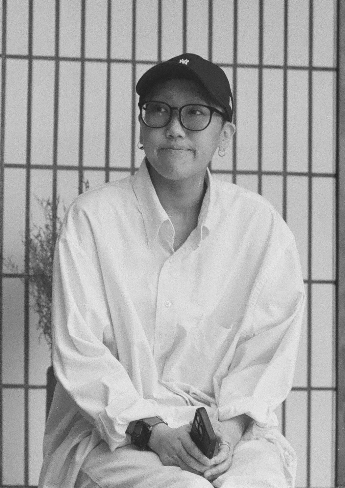

# 搞高



## 成員資料

Member ID：待配置
GitHub：properwork-studio

```yaml
discord_id: "482850842945388544"
```

## 我是誰

我最早的本行是行銷企劃與設計，從影展和藝術圈起家，當時也常做專訪。後來轉職成為工程師，曾在接案公司擔任技術主管兼 PM。

目前一邊接案，一邊探索接下來的方向。接案以網站開發與系統開發為主，目前進行中的案子包括中醫診所的庫存盤點系統，以及運動按摩的預約系統；也開始嘗試顧問與企業內訓。同時，我也在嘗試為藝文工作者做一些小工具。

會關注這件事，是因為身邊有藝文圈的朋友。和他們相處時，我意外發現藝文圈的數位化與系統化程度不高；很多人其實有意願學習 AI，卻不得其門而入。台灣藝文圈長期缺乏經費，從業人員常常一人身兼多職，就算有心研究 AI 相關資訊，也很難挪出時間。

## 我正在 build 的產品或專案

**逐字稿工作台**（目前在構想、調研與 MVP 階段，尚未公開 repo）

藝文與展覽工作者常需要把不同活動的錄音或影片轉成逐字稿，同一份逐字稿之後又會整理成不同用途的內容，例如活動新聞稿、內容素材、研究分析或展覽論述。因此，除了改善轉譯功能，也需要一個好用的編輯台介面，方便從同一份逐字稿延伸出各種內容。

另一個限制是，部分逐字稿的來源內容不適合上傳到雲端處理，所以有些成熟的雲端解決方案無法使用。最近也看到許多開源的逐字稿轉錄軟體，目前仍在參考與研究中。

## 為什麼想加入

我自己也還在探索階段，想多看看大家都在做什麼，和大家互相激盪想法。

另外，我很想參與知識與經驗的收集和傳承。因為我自己正處在有點徬徨的階段，常常不知道該去哪裡找這些資源；如果經驗能被整理、留下來，也能幫到和我一樣在找路的人。

## 想要獲得什麼

我覺得自己有一些技術，但還沒找到真正好的點子，也還沒有明確方向。目前最想釐清的是：

- **怎麼把接案轉成產品**：接案過程中累積的需求與做法，要怎麼判斷哪些值得做成產品。
- **認識正在找夥伴的人**：想認識想一起做點什麼、或正在找技術夥伴的人。
- **用技術服務非技術背景的人**：我想用自己的技術和能力，服務更多有需要的人，例如前面提到的藝文工作者，以及傳統中小企業。他們想了解或運用 AI，卻不知道從哪裡開始。我覺得新科技與這些族群之間存在數位落差，但還不確定實際情況，想多聽聽有相關經驗的人怎麼看。

## 想分享什麼

- **怎麼跟客戶談需求**：過去在接案公司擔任技術主管兼 PM，累積了不少和客戶釐清需求、溝通範圍的經驗。
- **做中小企業系統的心得**：過去在接案公司接觸的多半是中小企業的系統，可以分享在這類專案中看到的需求與做法。
- **藝文圈的第一手觀察**：我身邊有偏純藝術領域的朋友，可以分享從他們那裡聽到的實際工作情況與需求。

## 我的 Contributions：可以幫什麼忙、想要幫什麼忙

### 可以幫什麼忙

- **網站與系統開發**：組織或成員需要網站、系統或小工具時，可以協助開發。
- **釐清需求**：協助把模糊的想法整理成可以執行的需求與範圍。
- **技術諮詢**：對技術選擇、系統規劃或開發方式有疑問時，可以一起討論。
- **教非技術背景的人使用 AI**：協助想開始使用 AI 的人找到入口。
- **訪談與知識整理**：早年做過專訪，雖然是七、八年前的經驗了，但如果有訪談受訪者、整理筆記或知識資料的需要，也願意重拾老本行。

### 想要幫什麼忙

- **知識整理與訪談**：最想參與的部分。想協助訪談有經驗的人，並把內容整理成大家可以參考的知識筆記。
- **網站呈現**：也有興趣參與把整理好的知識放上網站、讓大家更容易瀏覽和找到的工作。

## 我對參與方式的理解

我願意遵守組織的憲法與現行制度，保有參與意願，依自己的時間以交流、學習或協作的方式參與。具體工作依自己的意願認領，接受後會負責完成；無法繼續時會說明並交接。

我目前以接案、顧問與企業內訓為業，這些工作與本組織無關，不會以組織的名義、知識內容或活動推廣；若有相關案件涉及組織，會依憲法揭露並迴避。
